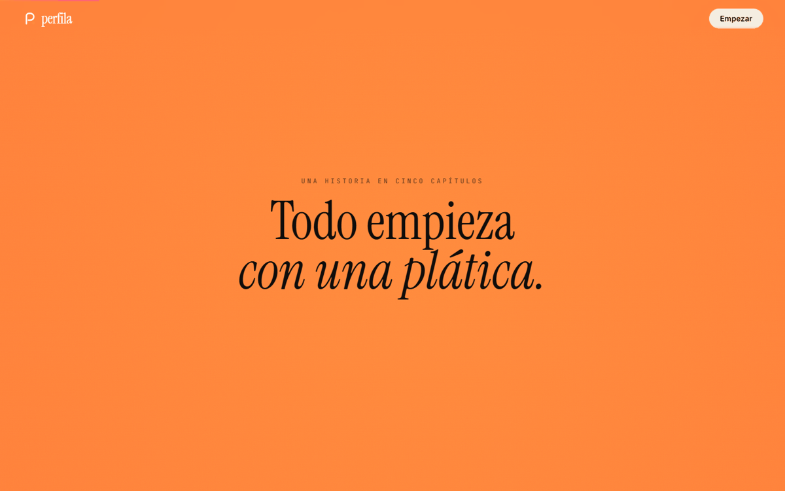

# Perfila — tu CV conversando

**Demo en vivo:** https://perfila-mx.netlify.app

Agente de IA que entrevista a personas que nunca han hecho un CV y arma un currículum honesto, listo para pasar filtros **ATS**, pensado para el mercado laboral de México. Chat a la izquierda, CV en vivo a la derecha.

> 🔒 El código fuente es privado. Este repositorio es una vitrina del proyecto: qué hace, cómo está hecho y pruebas de que funciona.

## Qué hace
- **Onboarding inmersivo:** nombre, momento de vida, puesto buscado, vacante, trato de tú/usted, foto y estilo.
- **Entrevista guiada por un agente** que usa herramientas:
  - `actualizar_cv`: escribe secciones del CV y se ven en vivo.
  - `mostrar_opciones`: botones de respuesta rápida.
  - `evaluar_ats`: puntaje, mejoras y palabras clave que faltan.
- **Investigación de vacantes reales:** al terminar el onboarding, Claude busca en la web qué piden las vacantes del puesto en México y devuelve una guía con fuentes.
- **Medidor ATS local**, instantáneo y sin IA.
- **Exporta** a Word (.docx), PDF (con texto real, no imagen) y .txt.

## Stack
| Capa | Tecnología |
|---|---|
| Frontend | React + Vite + TypeScript, Motion |
| IA | Claude (Anthropic API): herramientas, streaming SSE, búsqueda web |
| Backend | Netlify Functions: un turno del modelo por petición para caber en el límite de 60 s |
| Documentos | `docx` para Word; impresión del navegador para PDF |

## Capturas
| Escritorio | Móvil |
|---|---|
|   |  |
